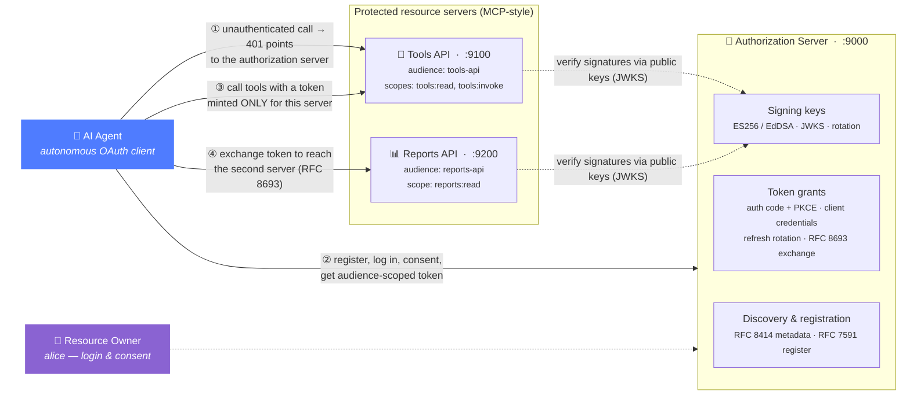
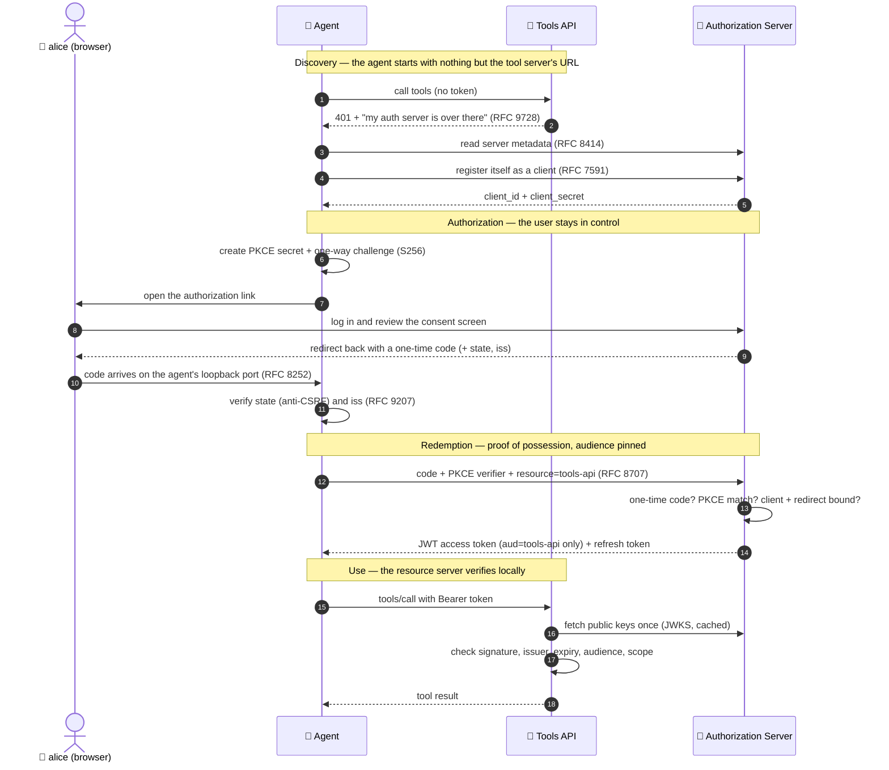
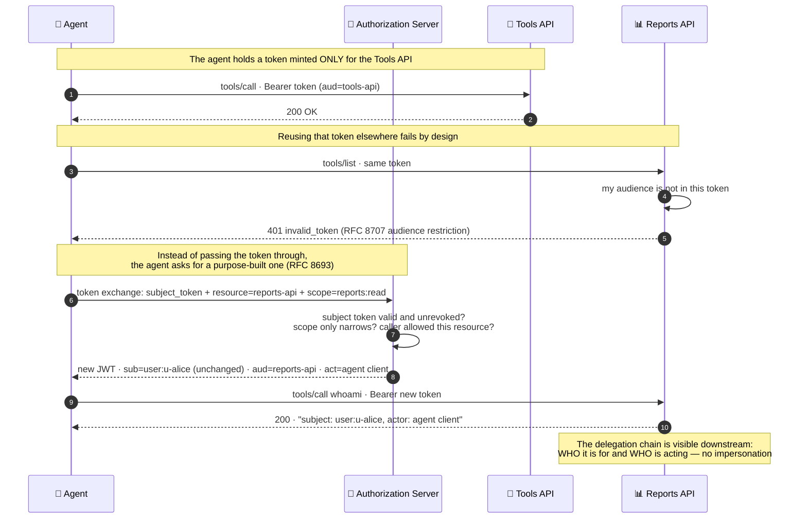
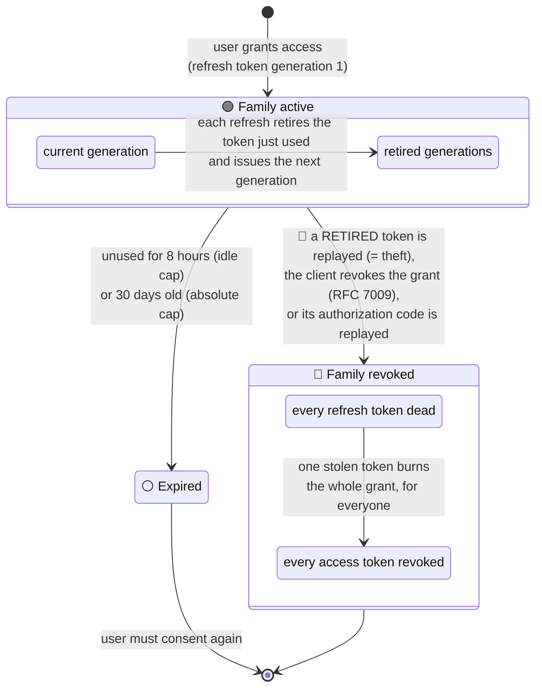

# OAuth 2.1 Authorization Server for MCP & AI Agents

[](https://github.com/jjsanda/oauth_authorization_server_for_mcp_and_ai_agent/actions/workflows/ci.yml)
[](https://goreportcard.com/report/github.com/jjsanda/oauth_authorization_server_for_mcp_and_ai_agent)
[](go.mod)
[](LICENSE)
[](go.mod)

An **OAuth 2.1 authorization server**, an **MCP-style protected resource
server**, and an **autonomous agent client** that exercises the entire
protocol — written in Go with **zero third-party dependencies**. Every token is
created, checked, rotated, exchanged, and revoked by code in this repository —
no auth libraries, only Go's standard library.

---

## Why

AI agents are becoming API clients. When an agent connects to a tool server —
for example over the [Model Context Protocol](https://modelcontextprotocol.io/specification/draft/basic/authorization)
(MCP) — somebody has to answer the oldest questions in security: *who is this,
what may it do, on whose behalf, and how do we take that permission back?*

The MCP authorization specification answers them with OAuth 2.1, and adds two
requirements that this project treats as first-class:

- **Audience-restricted tokens** ([RFC 8707](https://www.rfc-editor.org/rfc/rfc8707)):
  every access token names the specific server it may be presented to. A token
  for the Tools API is cryptographically useless at the Reports API — like a
  hotel keycard that opens exactly one door, a stolen token cannot be redeemed
  anywhere else.
- **No token passthrough**: an agent must never forward the token it received
  onward to another service. Instead it performs a **token exchange**
  ([RFC 8693](https://www.rfc-editor.org/rfc/rfc8693)). The authorization
  server issues a new, narrower token for the downstream service that records
  *both* the user it is for and the agent acting on their behalf — so the
  delegation chain stays visible and auditable.

## What's inside

| Component | Binary | What it does |
|---|---|---|
| 🔐 **Authorization server** | `cmd/authserver` | Discovery, dynamic client registration, login & consent UI, four token grants, introspection, revocation, JWKS with key rotation |
| 🧰 **Resource server** | `cmd/resourceserver` | MCP-style JSON-RPC tools that check tokens themselves, without calling the authorization server; deployed twice (Tools API + Reports API) so audience restriction is demonstrable |
| 🤖 **Agent client** | `cmd/agent` | Starts with nothing but a resource URL and walks the whole protocol, asserting each step; doubles as the end-to-end test |



## Quickstart

**Prerequisites:** Docker with Compose v2 for the container path; Go 1.22+ for
the native path.

### Watch the whole protocol run (Docker)

```console
$ make demo          # or: ./scripts/demo.sh
```

builds the images, starts the stack, and runs the agent through twelve
narrated steps — discovery, registration, login, consent, PKCE, audience
rejection, token exchange, refresh rotation, a simulated token theft, and the
revocation cascade it triggers:

```text
[ 7] Try the SAME token against http://reports-api:9200 (different audience)
     rejected with 401: tokens do not cross resource servers

[ 8] Exchange the token for a http://reports-api:9200-audienced one (RFC 8693)
     whoami → subject=user:u-alice actor=client:3IVSKo… (delegation is visible downstream)

[10] Replay the RETIRED refresh token (simulated theft)
     rejected with invalid_grant — reuse detected

[11] Verify the whole family is dead, including the NEWEST token
     newest refresh token also rejected: the theft burned the grant for everyone
```

The agent exits non-zero if **any** step deviates from the spec — the demo *is*
the end-to-end test, and CI runs it on every push to `main` and every pull
request.

### Walk the login flow yourself (browser)

```console
$ make run-auth                        # authorization server on :9000
$ make run-rs                          # tools API on :9100 (second terminal)
$ go run ./cmd/agent -mode auth-code   # third terminal
```

The agent prints an authorization URL. Open it, sign in as **`alice`** /
**`password`**, review the consent screen, and approve — the callback lands on
the agent's loopback port and the agent completes the authorization-code
scenario. (Add a second resource server on `:9200` plus
`-exchange-for http://localhost:9200 -demo-refresh-replay` to walk the full
twelve steps.)

### Machine-to-machine in two curl calls

```console
$ curl -u "demo-m2m:demo-m2m-secret-Kt5v9pQ2wX7zR4mN" \
       -d "grant_type=client_credentials&resource=http://localhost:9100" \
       http://localhost:9000/token
$ curl -H "Authorization: Bearer <access_token>" \
       -d '{"jsonrpc":"2.0","id":1,"method":"tools/call","params":{"name":"whoami"}}' \
       http://localhost:9100/mcp
```

## The authorization code flow, end to end

The heart of the protocol: a user delegates access to an agent without ever
giving it their password, and proof-of-possession (PKCE) makes an intercepted
code worthless.



## Token exchange: delegation without passthrough



## Refresh tokens: rotation with theft detection

Refresh tokens are the longest-lived secret in the system, so they rotate on
every use and form a *family*. Presenting a retired generation is proof that
the token leaked — and the response is to burn the entire grant:



Rendered SVGs of all diagrams live in [`docs/diagrams/`](docs/diagrams/).

## Standards implemented

| Standard | What | Where |
|---|---|---|
| [RFC 6749](https://www.rfc-editor.org/rfc/rfc6749) / [OAuth 2.1](https://datatracker.ietf.org/doc/draft-ietf-oauth-v2-1/) | Authorization framework: auth code + client credentials, §5.2 errors | [`internal/authserver`](internal/authserver), [`internal/oauth/errors.go`](internal/oauth/errors.go) |
| [RFC 6750](https://www.rfc-editor.org/rfc/rfc6750) | Bearer token usage, `WWW-Authenticate` challenges | [`internal/resourceserver/authmw.go`](internal/resourceserver/authmw.go) |
| [RFC 7009](https://www.rfc-editor.org/rfc/rfc7009) | Token revocation (family-wide for refresh tokens) | [`internal/authserver/revoke.go`](internal/authserver/revoke.go) |
| [RFC 7515](https://www.rfc-editor.org/rfc/rfc7515) / [7517](https://www.rfc-editor.org/rfc/rfc7517) / [7518](https://www.rfc-editor.org/rfc/rfc7518) | JWS compact signing, JWK/JWKS, ES256 (P-1363 encoding) | [`internal/jose`](internal/jose) |
| [RFC 7519](https://www.rfc-editor.org/rfc/rfc7519) | JSON Web Token claims | [`internal/token/claims.go`](internal/token/claims.go) |
| [RFC 7591](https://www.rfc-editor.org/rfc/rfc7591) | Dynamic client registration | [`internal/authserver/register.go`](internal/authserver/register.go) |
| [RFC 7636](https://www.rfc-editor.org/rfc/rfc7636) | PKCE, S256 only (appendix B test vector) | [`internal/oauth/pkce.go`](internal/oauth/pkce.go) |
| [RFC 7638](https://www.rfc-editor.org/rfc/rfc7638) | JWK thumbprints as key IDs (RFC 8037 A.3 vector) | [`internal/jose/jwk.go`](internal/jose/jwk.go) |
| [RFC 7662](https://www.rfc-editor.org/rfc/rfc7662) | Token introspection with caller entitlement | [`internal/authserver/introspect.go`](internal/authserver/introspect.go) |
| [RFC 8037](https://www.rfc-editor.org/rfc/rfc8037) | EdDSA (Ed25519) signatures | [`internal/jose/jws.go`](internal/jose/jws.go) |
| [RFC 8252](https://www.rfc-editor.org/rfc/rfc8252) | Native-app loopback redirects | [`internal/agent/authcode.go`](internal/agent/authcode.go) |
| [RFC 8414](https://www.rfc-editor.org/rfc/rfc8414) | Authorization server metadata | [`internal/authserver/metadata.go`](internal/authserver/metadata.go) |
| [RFC 8693](https://www.rfc-editor.org/rfc/rfc8693) | Token exchange with `act` claim | [`internal/authserver/grant_exchange.go`](internal/authserver/grant_exchange.go) |
| [RFC 8707](https://www.rfc-editor.org/rfc/rfc8707) | Resource indicators — mandatory on every grant | [`internal/authserver/token_endpoint.go`](internal/authserver/token_endpoint.go) |
| [RFC 9068](https://www.rfc-editor.org/rfc/rfc9068) | JWT access token profile (`at+jwt`) | [`internal/token`](internal/token) |
| [RFC 9207](https://www.rfc-editor.org/rfc/rfc9207) | `iss` on authorization responses (mix-up defense) | [`internal/authserver/authorize.go`](internal/authserver/authorize.go) |
| [RFC 9728](https://www.rfc-editor.org/rfc/rfc9728) | Protected resource metadata (MCP discovery) | [`internal/resourceserver/prmetadata.go`](internal/resourceserver/prmetadata.go) |
| [MCP authorization](https://modelcontextprotocol.io/specification/draft/basic/authorization) | Discovery pattern, audience binding, no passthrough | throughout |

## Security decisions

The full rationale for each lives in [`docs/security.md`](docs/security.md);
the highlights:

- **No `alg` confusion by construction** — the verifier takes the algorithm
  from the server-side key record, never from the token header; `alg:none`
  cannot exist.
- **PKCE S256 only** — the downgrade-prone `plain` method is rejected at
  `/authorize`, verifiers are charset/length-validated, comparison is
  constant-time.
- **Exact redirect URI matching** — no prefixes, no wildcards; an untrusted
  `client_id`/`redirect_uri` renders a local error page and *never* redirects.
- **Every bearer secret is stored hashed** (SHA-256 of server-generated
  256-bit values) and compared with `crypto/subtle`. A leaked store contains
  nothing redeemable.
- **One-time authorization codes** — 60-second TTL, atomically consumed;
  a replayed code revokes every token its first redemption produced.
- **Audience is always an array, always enforced** — a resource server
  requires its own identifier in `aud`; requests without a valid `resource`
  parameter fail with `invalid_target`.
- **Scope and resources only narrow** on refresh and exchange, never widen.
- **Sessions and consent** — HMAC-signed HttpOnly SameSite=Lax cookies
  (Secure over https), session-bound CSRF on consent, a signed double-submit
  guard against login CSRF, authorization parameters parked server-side.
- **Auditable decisions** — every grant, denial, replay, and revocation is a
  structured log line with request IDs.
- **Key rotation without downtime** — retired keys stay in the JWKS until
  their tokens expire; resource servers pick up new keys on first unknown
  `kid`, rate-limited against forced-refresh abuse.

## Project layout

```text
cmd/
  authserver/          the authorization server binary
  resourceserver/      the resource server binary (run once per identity)
  agent/               the demo agent / e2e assertion binary
internal/
  jose/                minimal JOSE: JWS (ES256, EdDSA), JWK/JWKS, thumbprints, key set
  oauth/               protocol vocabulary: errors, PKCE, scopes, secret hashing
  token/               RFC 9068 access token issuer and verifier
  store/               persistence model + narrow interfaces; memory/ implementation
  httpx/               server timeouts, graceful shutdown, request-ID/log/recover middleware
  authserver/          endpoints: metadata, JWKS, authorize, login, consent, token
                       (4 grants), register, introspect, revoke
  resourceserver/      JWKS client, bearer middleware, RFC 9728 metadata, JSON-RPC tools
  agent/               discovery, registration, PKCE + loopback, headless login, scenario
  e2e/                 full-story test wiring everything in-process
docs/
  diagrams/            Mermaid sources + rendered SVGs
  security.md          threat-by-threat design rationale
```

## Configuration

All settings have working defaults; flags override environment variables.

| Variable | Default | Meaning |
|---|---|---|
| `AUTH_ADDR` | `:9000` | authorization server listen address |
| `AUTH_ISSUER` | `http://localhost:9000` | public issuer URL (the `iss` claim) |
| `AUTH_SIGNING_ALG` | `ES256` | `ES256` or `EdDSA` |
| `AUTH_SIGNING_KEY_FILE` | *(ephemeral)* | PKCS#8 PEM key; generated per start when unset |
| `DEMO_RESOURCES` | both demo APIs | resource registry + what demo clients may request |
| `RS_ADDR` / `RS_RESOURCE` / `RS_ISSUER` | `:9100` / `http://localhost:9100` / `http://localhost:9000` | resource server identity |
| `RS_SCOPE_LIST` / `RS_SCOPE_CALL` | `tools:read` / `tools:invoke` | scopes required per method |
| `LOG_LEVEL` / `LOG_FORMAT` | `info` / `text` | `debug…error`, `text` or `json` |

The agent binary reads `AGENT_RESOURCE`, `AGENT_MODE`, `AGENT_EXCHANGE_FOR`,
`AGENT_DEMO_REFRESH_REPLAY`, `AGENT_USERNAME`, and `AGENT_PASSWORD` (each with a
matching flag); see the doc comment on `cmd/agent`.

## Testing

```console
$ make test    # unit + handler + e2e tests
$ make race    # same, under the race detector
$ make lint    # gofmt + go vet + golangci-lint
$ make e2e     # just the full-story tests, verbose
$ make demo    # the containerized story (what CI's e2e job runs)
```

Highlights: RFC 7636 and RFC 8037 test vectors, a DER-vs-P1363 signature
regression test, refresh-reuse matrices, concurrency tests proving exactly-one
redemption under contention, and the agent's narrated story run end-to-end
with both signing algorithms exercised.

## Non-goals and production notes

This is a complete, correct protocol implementation with deliberately simple
operational choices, so the protocol logic stays readable:

- **In-memory storage.** The store interfaces are narrow and transactional by
  design; a SQL implementation slots in without touching protocol code.
- **TLS termination is out of scope** — run it behind a reverse proxy; the
  code never puts tokens in URLs, so logs stay clean either way.
- **Demo users with demo passwords.** Real deployments should federate login
  to an IdP (or at minimum use a memory-hard KDF); `docs/security.md` explains
  why the *client* secrets deliberately use plain hashed storage instead.
- **Open dynamic registration** — appropriate for the MCP agent pattern, but
  production deployments would gate `/register` with initial access tokens.
- **Future work:** sender-constrained tokens (DPoP, RFC 9449) and pushed
  authorization requests (PAR, RFC 9126) are the natural next hardening steps.

## License

[Apache-2.0](LICENSE) © Josef Sanda
